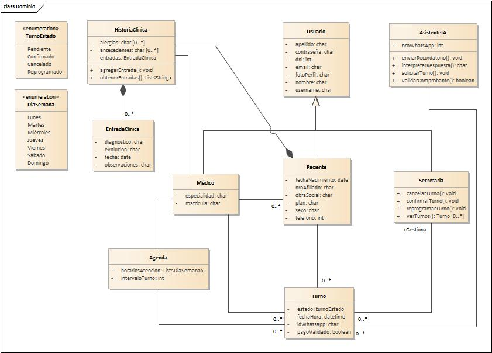
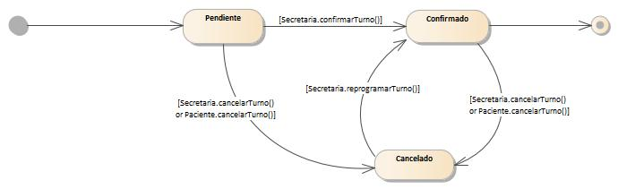

## Fase 2: Modelado de Dominio

### 2.1 Modelo de dominio

**Justificación del Modelo:**

Se modelaron las entidades del sistema a partir del documento de visión y 
alcance de IMOS. La clase 'Turno' actúa como eje central, gestionando el 
ciclo de vida de cada cita mediante la enumeración 'TurnoEstado'. La jerarquía 
'Usuario → Medico / Secretaria' centraliza los datos de acceso y 
separa responsabilidades por rol. La 'Agenda' del médico define la 
disponibilidad horaria, mientras que 'HistoriaClinica' y 'EntradaClinica'
registran la evolución clínica de cada paciente. Finalmente, 'AsistenteIA' 
encapsula toda la comunicación automática por WhatsApp, desacoplando esa 
lógica del personal del consultorio.

### 2.2 Requisitos funcionales
| ID | REQUERIMIENTO | DESCRIPCIÓN | MÓDULO |
|----|---------------|-------------|--------|
| RF01.1 | Registrar paciente | Permite dar de alta un nuevo paciente con sus datos personales | Gestión de Pacientes |
| RF01.2 | Editar paciente | Permite modificar los datos personales de un paciente ya registrado en el sistema | Gestión de Pacientes |
| RF01.3 | Buscar paciente | Permite buscar y consultar pacientes registrados | Gestión de Pacientes |
| RF01.4 | Registrar nota clínica | Permite registrar notas por consulta | Gestión de Pacientes |
| RF01.5 | Visualizar historial clínico | Permite ver el historial clínico completo de un paciente con todas sus consultas previas | Gestión de Pacientes |
| RF01.6 | Asociar nota a consulta | Cada nota clínica queda vinculada a una consulta específica | Gestión de Pacientes |
| RF02.1 | Crear turno | Permite registrar un nuevo turno para un paciente en una fecha y hora disponible | Gestión de Turnos |
| RF02.2 | Modificar turno | Permite editar los datos de un turno existente | Gestión de Turnos |
| RF02.3 | Cancelar turno | Permite cancelar un turno | Gestión de Turnos |
| RF02.4 | Reprogramar turno | Permite mover un turno a un nuevo horario o fecha | Gestión de Turnos |
| RF03.1 | Vista de agenda diaria | Muestra los turnos del día actual en formato calendario | Agenda y Calendario |
| RF03.2 | Vista de agenda semanal | Muestra los turnos de la semana en formato calendario | Agenda y Calendario |
| RF03.3 | Mostrar solo turnos confirmados | La agenda definitiva solo exhibe turnos en estado "confirmado" | Agenda y Calendario |
| RF04.1 | Registrar médico | Permite dar de alta un nuevo médico con sus datos correspondientes | Gestión de Usuarios |
| RF04.2 | Definir días disponibles | El médico puede indicar qué días de la semana está disponible para atención | Disponibilidad del Médico |
| RF04.3 | Configurar horario de atención | El médico puede establecer la hora de inicio y fin de atención por día | Disponibilidad del Médico |
| RF04.4 | Establecer duración de turno | Permite definir la duración estándar de cada turno | Disponibilidad del Médico |
| RF04.5 | Bloquear franjas horarias | Permite bloquear horarios específicos para que no se asignen turnos | Disponibilidad del Médico |

### 2.3 Reglas de negocio
| Id     | Regla                              | Descripcion                                                                 |
|--------|------------------------------------|-----------------------------------------------------------------------------|
| RN-001 | Respeto de disponibilidad          | Los pacientes solo pueden solicitar turnos dentro de los días y horarios definidos por el médico. |
| RN-002 | No superposición de turnos         | No se podrán registrar dos turnos confirmados en el mismo horario para el mismo médico. |
| RN-003 | Registro obligatorio de paciente   | Para solicitar un turno, el paciente debe estar previamente registrado en el sistema con sus datos básicos. |
| RN-004 | Control de acceso por rol          | El acceso a funcionalidades del sistema debe estar restringido según el rol del usuario (médico, secretaria, paciente). |
| RN-005 | Tiempo límite de confirmación      | Un turno en estado pendiente debe confirmarse dentro de un tiempo límite de 48hs, caso contrario se cancela automáticamente. |
| RN-006 | Cancelación anticipada mínima      | El paciente podrá cancelar el turno antes de la confirmación del mismo. |
| RN-007 | Asociación obligatoria consulta–turno | No puede registrarse una consulta médica sin que exista un turno asociado. |
| RN-008 | Validación de horario futuro       | No se pueden solicitar turnos en fechas u horarios pasados. |
| RN-009 | Exclusividad del rol médico        | Solo el médico puede registrar diagnósticos y observaciones clínicas. |
| RN-0010 | Cierre de agenda por período de ausencia | El médico puede definir períodos de ausencia (vacaciones, licencias, congresos) en los cuales la agenda queda cerrada automáticamente. Durante este período no se pueden solicitar ni asignar turnos, y los ya confirmados deben ser notificados y reprogramados. |
| RN-0011 | Auditoría de cambios              | Toda modificación sobre turnos o datos de pacientes debe registrar fecha, hora y usuario responsable. |

### 2.4 Modelos Complementarios
 

