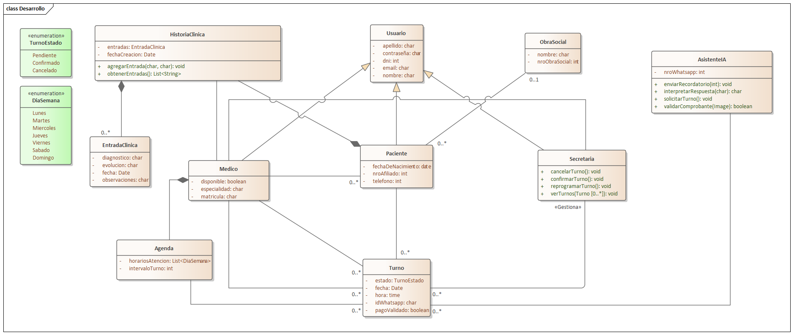

# Proyecto IMOS - Backlog

## Fase 1: Preparación y Análisis Inicial

### 1.1 Alcance, módulos y límites
(Responsable: Castellani Martina)

### 1.2 Glosario de términos
(Responsable: Giannelli Pilar)

------------------------------------------

## Fase 2: Modelado de Dominio

### 2.1 Modelo de dominio
(Responsable: Basoalto Ezequiel)

**Justificación del Modelo:**

Se modelaron las entidades del sistema a partir del documento de visión y 
alcance de IMOS. La clase 'Turno' actúa como eje central, gestionando el 
ciclo de vida de cada cita mediante la enumeración 'TurnoEstado'. La jerarquía 
'Usuario → Medico / Paciente / Secretaria' centraliza los datos de acceso y 
separa responsabilidades por rol. La 'Agenda' del médico define la 
disponibilidad horaria, mientras que 'HistoriaClinica' y 'EntradaClinica'
registran la evolución clínica de cada paciente. Finalmente, 'AsistenteIA' 
encapsula toda la comunicación automática por WhatsApp, desacoplando esa 
lógica del personal del consultorio.

### 2.2 Requisitos funcionales
(Responsable: Román Augusto)

### 2.3 Reglas de negocio
(Responsable: Terruli Tomás)

### 2.4 Modelos Complementarios
(Responsable: Figueroa Rodrigo)
