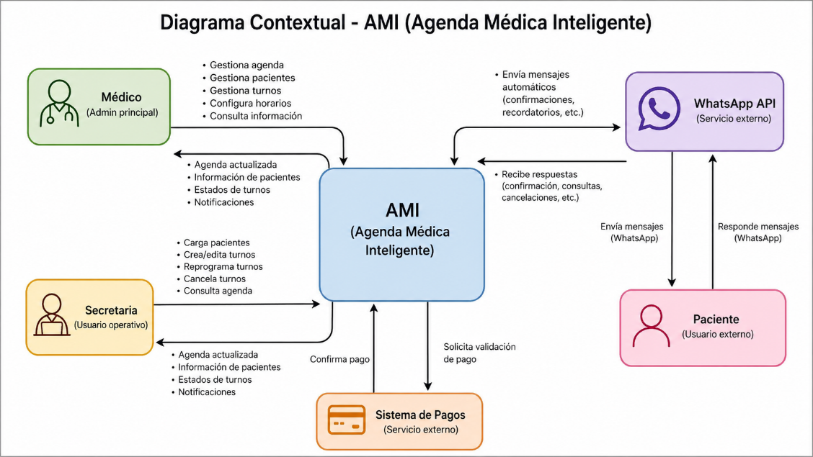
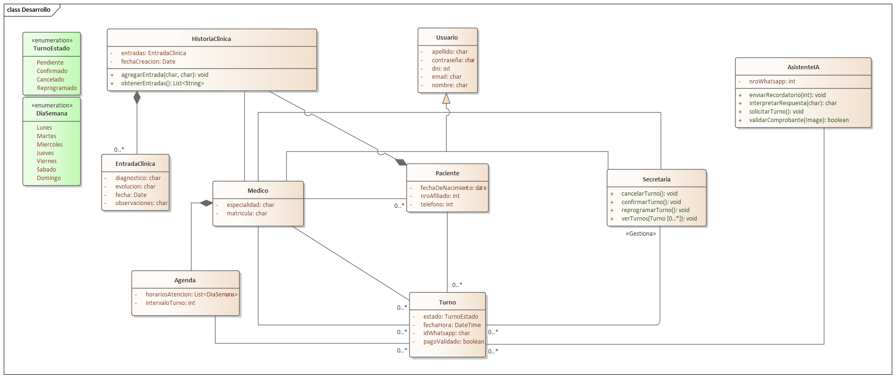

# Proyecto IMOS - Backlog

## Fase 1: Preparación y Análisis Inicial

### 1.1 Alcance, módulos y límites

### ¿Qué problema resuelve? 

El consultorio de traumatología de IMOS Saladillo gestiona turnos y pacientes de forma completamente manual: WhatsApp individual, llamadas, papel y planillas. Esto genera una tasa alta de ausentismo, falta de estados formales para los turnos, historial clínico fragmentado y una carga operativa insostenible para el médico y la secretaria.

### ¿Quiénes son los usuarios?

Médico traumatólogo: gestiona la agenda, configura horarios y consulta historial clínico.

Secretaria/personal administrativo: carga pacientes, administra turnos manualmente cuando es necesario.

Paciente: actor externo. Interactúa únicamente por WhatsApp (no accede al sistema web).

### ¿Qué PUEDE hacer el sistema?

Registrar, editar y consultar pacientes con historial clínico básico (diagnóstico, evolución, observaciones).

Crear, modificar, cancelar y reprogramar turnos con estados definidos: pendiente, confirmado, cancelado, reprogramado.

Mostrar una vista de agenda tipo calendario (diaria y semanal).

Configurar la disponibilidad del médico: días, duración de turnos, bloqueos de horarios.

Automatizar la comunicación por WhatsApp mediante un agente de IA: confirmación de asistencia, validación de pago y recordatorios previos al turno.

Aplicar lógica de confirmación: un turno solo pasa a "confirmado" cuando el paciente confirma asistencia y pago (si corresponde).

### ¿Qué NO puede hacer el sistema? (límites explícitos)

No genera recetas digitales, certificados médicos ni historia clínica electrónica completa.

No incluye módulo de facturación, cobro en línea ni integración con obras sociales o prepagas.

No tiene versión móvil nativa (iOS/Android); es exclusivamente web responsive.

No soporta múltiples médicos ni especialidades en esta versión.

No incluye videoconsultas ni telemedicina.

No tiene estadísticas ni reportes avanzados de gestión.

No se comunica por canales distintos a WhatsApp (sin SMS, email ni Telegram).

---

## 2. Sistemas Externos con los que Interactúa

| Sistema externo | Tipo de interacción | Tecnología probable |
|----------------|---------------------|---------------------|
| WhatsApp Business | Envío/recepción de mensajes automatizados con pacientes | API oficial de WhatsApp (Meta Cloud API o Twilio) |
| Agente de IA | Procesa conversaciones con pacientes, interpreta respuestas y toma decisiones (confirmar, recordar, pedir pago) | LLM externo (ej. OpenAI, Anthropic API) o modelo propio |
| Sistema de autenticación | Control de acceso al panel web para médico y secretaria | Propio o servicio externo (OAuth, Auth0, etc.) |
| Servidor de archivos / BD | Almacenamiento de historial clínico, datos de pacientes y turnos | Propio (base de datos relacional + almacenamiento) |

---

## 3. Preguntas para el Cliente (Zonas Grises)

Estas son las dudas que deben resolverse antes de avanzar al diseño detallado:

Flujo de confirmación de turno: ¿El paciente primero confirma asistencia y luego pago, o puede hacerlo en cualquier orden? ¿Qué sucede si confirma asistencia pero no el pago?

Validación de pago: ¿Cómo valida el paciente que pagó? ¿Envía una captura de pantalla por WhatsApp, o simplemente responde "pagué"? ¿Quién valida esa información?

Turnos sin pago: ¿Hay pacientes que no pagan antes del turno (obras sociales, convenios)? ¿Para ellos se omite la validación de pago?

Gestión de la secretaria: ¿La secretaria puede crear turnos directamente sin que pasen por el flujo de WhatsApp? ¿Tiene los mismos permisos que el médico?

Número de WhatsApp: ¿El consultorio ya tiene (o puede obtener) un número exclusivo para el sistema automatizado? ¿O se reutiliza el número personal del médico?

Recordatorios: ¿Con cuánta anticipación deben enviarse los recordatorios? ¿Uno o más recordatorios por turno? ¿El médico puede configurar este tiempo?

Historial clínico: ¿Existen datos de pacientes previos para migrar? ¿En qué formato están (papel, Excel)? ¿Quién realiza la carga inicial?

Cancelaciones por el médico: Si el médico cancela un turno, ¿el sistema notifica automáticamente al paciente por WhatsApp?

Acceso multiusuario simultáneo: ¿El médico y la secretaria usarán el sistema al mismo tiempo? ¿Desde dispositivos distintos?

Idioma del agente de IA: ¿Las respuestas automáticas son solo en español? ¿Deben tener un tono formal o informal?

---

## 4. Diagrama Contextual

### 1.2 Glosario de términos

El siguiente glosario reúne los términos clave del dominio del sistema. Su propósito es eliminar ambigüedades dentro del equipo de desarrollo y servir como base para el modelo de dominio (Fase 2). Las definiciones están contextualizadas en el funcionamiento real del sistema y validadas contra el documento de visión y alcance.

| Término | Definición | Sinónimos | Módulo |
|---|---|---|---|
| Paciente | Persona registrada en el sistema que tiene o ha tenido turnos en el consultorio de traumatología de IMOS. El sistema almacena sus datos personales y su historial clínico básico. | – | Pacientes |
| Historial clínico | Registro acumulado de las consultas de un paciente: diagnósticos, evolución del tratamiento y observaciones por visita. No incluye recetas ni certificados médicos. | Historia clínica | Pacientes |
| Consulta | Cada visita registrada de un paciente al médico. Queda asentada en el historial clínico con fecha, diagnóstico y observaciones. | Visita | Pacientes |
| Diagnóstico | Descripción del problema médico identificado durante una consulta. Se registra como parte de la entrada correspondiente en el historial clínico. | – | Pacientes |
| Evolución | Seguimiento del estado clínico del paciente a lo largo de sucesivas consultas. Permite al médico ver cómo progresó un tratamiento. | Seguimiento | Pacientes |
| Turno | Cita programada entre un paciente y el médico para una fecha y hora determinadas. Es la unidad central del sistema y posee un estado que varía durante su ciclo de vida. | Cita, Consulta | Turnos |
| Estado del turno | Situación en la que se encuentra un turno en un momento dado. Los estados posibles son: Pendiente, Confirmado, Cancelado y Reprogramado. | – | Turnos |
| Turno pendiente | Turno creado pero aún no confirmado por el paciente. No figura en la agenda definitiva del médico hasta que se complete la confirmación. | Turno en espera | Turnos |
| Turno confirmado | Turno que el paciente confirmó explícitamente (y validó el pago, si corresponde). Solo en este estado el turno se incorpora a la agenda definitiva del médico. | – | Turnos |
| Turno cancelado | Turno que fue anulado por el paciente o el personal antes de que se llevara a cabo la consulta. | – | Turnos |
| Turno reprogramado | Turno que fue modificado para una nueva fecha u hora, generando un nuevo turno en estado Pendiente y dejando el original marcado como Reprogramado. | – | Turnos |
| Confirmación | Acción mediante la cual el paciente indica, a través de WhatsApp, que asistirá a su turno. Es condición necesaria para que el turno pase al estado Confirmado. | Confirmación de asistencia | Turnos |
| Ausentismo | Fenómeno por el cual un paciente no se presenta a su turno sin haberlo cancelado previamente. Es el principal problema que el sistema busca reducir. | No presentismo | Turnos |
| Reprogramación | Operación que permite mover un turno existente a una nueva fecha u hora. El sistema genera un nuevo turno y actualiza el estado del original. | – | Turnos |
| Agenda | Vista consolidada de los turnos confirmados del médico, organizada en formato calendario diario y semanal. Solo muestra turnos en estado Confirmado. | Calendario | Agenda |
| Bloque horario | Franja de tiempo disponible para asignar un turno, definida por la configuración del médico. Su duración es fija y configurable (por ejemplo, 30 minutos por turno). | Slot, Franja horaria | Agenda |
| Vista diaria | Presentación de la agenda que muestra todos los turnos confirmados correspondientes a un día específico. | – | Agenda |
| Vista semanal | Presentación de la agenda que muestra los turnos confirmados distribuidos a lo largo de los siete días de la semana seleccionada. | – | Agenda |
| Horario de atención | Conjunto de días y franjas horarias en los que el médico está disponible para recibir pacientes. Define qué bloques horarios pueden asignarse a turnos. | Disponibilidad | Configuración |
| Duración del turno | Tiempo en minutos que se reserva para cada consulta. Determina la cantidad de bloques horarios disponibles por día. | – | Configuración |
| Bloqueo de horario | Marcación de un bloque horario como no disponible, impidiendo que se generen turnos en ese intervalo (vacaciones, reuniones, feriados). | Horario bloqueado | Configuración |
| Agente de IA | Componente del sistema que gestiona de forma autónoma la comunicación con los pacientes por WhatsApp. Interpreta mensajes, envía respuestas y ejecuta acciones como confirmar turnos o solicitar pagos. | Bot, Asistente virtual | Comunicación |
| Recordatorio | Mensaje automático enviado al paciente por WhatsApp antes de la fecha del turno, con el objetivo de reducir el ausentismo. | Notificación previa | Comunicación |
| Flujo de confirmación | Secuencia de mensajes intercambiados entre el agente de IA y el paciente a través de WhatsApp para validar su asistencia y, si aplica, su pago, hasta que el turno quede en estado Confirmado. | – | Comunicación |
| Canal de comunicación | Medio a través del cual el sistema se contacta con los pacientes. En esta versión, el único canal soportado es WhatsApp. | – | Comunicación |
| WhatsApp Business API | Servicio externo utilizado para enviar y recibir mensajes de WhatsApp de forma programática. El agente de IA opera sobre este canal para gestionar los flujos de confirmación y recordatorio. | API de WhatsApp | Comunicación |
| Médico | Usuario principal del sistema. Gestiona su agenda, accede al historial clínico de los pacientes y configura sus horarios de atención. | Médico traumatólogo | Usuarios |
| Personal administrativo | Usuario secundario del sistema. Puede registrar pacientes y gestionar turnos, pero no tiene acceso al historial clínico. | Secretaria, Admin | Usuarios |
| Rol | Perfil de acceso asignado a cada usuario del sistema que determina qué funcionalidades puede ver y operar. Los roles definidos son: Médico y Personal Administrativo. | Perfil de usuario | Usuarios |

------------------------------------------

## Fase 2: Modelado de Dominio

### 2.1 Modelo de dominio
(Responsable: Basoalto Ezequiel)

**Justificación del Modelo:**

Se modelaron las entidades del sistema a partir del documento de visión y 
alcance de IMOS. La clase 'Turno' actúa como eje central, gestionando el 
ciclo de vida de cada cita mediante la enumeración 'TurnoEstado'. La jerarquía 
'Usuario → Medico / Secretaria' centraliza los datos de acceso y 
separa responsabilidades por rol. La 'Agenda' del médico define la 
disponibilidad horaria, mientras que 'HistoriaClinica' y 'EntradaClinica'
registran la evolución clínica de cada paciente. Finalmente, 'AsistenteIA' 
encapsula toda la comunicación automática por WhatsApp, desacoplando esa 
lógica del personal del consultorio.

### 2.2 Requisitos funcionales
| ID | REQUERIMIENTO | DESCRIPCIÓN | MÓDULO |
|----|---------------|-------------|--------|
| RF01.1 | Registrar paciente | Permite dar de alta un nuevo paciente con sus datos personales | Gestión de Pacientes |
| RF01.2 | Editar paciente | Permite modificar los datos personales de un paciente ya registrado en el sistema | Gestión de Pacientes |
| RF01.3 | Buscar paciente | Permite buscar y consultar pacientes registrados | Gestión de Pacientes |
| RF01.4 | Registrar nota clínica | Permite registrar notas por consulta | Gestión de Pacientes |
| RF01.5 | Visualizar historial clínico | Permite ver el historial clínico completo de un paciente con todas sus consultas previas | Gestión de Pacientes |
| RF01.6 | Asociar nota a consulta | Cada nota clínica queda vinculada a una consulta específica | Gestión de Pacientes |
| RF02.1 | Crear turno | Permite registrar un nuevo turno para un paciente en una fecha y hora disponible | Gestión de Turnos |
| RF02.2 | Modificar turno | Permite editar los datos de un turno existente | Gestión de Turnos |
| RF02.3 | Cancelar turno | Permite cancelar un turno | Gestión de Turnos |
| RF02.4 | Reprogramar turno | Permite mover un turno a un nuevo horario o fecha | Gestión de Turnos |
| RF03.1 | Vista de agenda diaria | Muestra los turnos del día actual en formato calendario | Agenda y Calendario |
| RF03.2 | Vista de agenda semanal | Muestra los turnos de la semana en formato calendario | Agenda y Calendario |
| RF03.3 | Mostrar solo turnos confirmados | La agenda definitiva solo exhibe turnos en estado "confirmado" | Agenda y Calendario |
| RF04.1 | Definir días disponibles | El médico puede indicar qué días de la semana está disponible para atención | Disponibilidad del Médico |
| RF04.2 | Configurar horario de atención | El médico puede establecer la hora de inicio y fin de atención por día | Disponibilidad del Médico |
| RF04.3 | Establecer duración de turno | Permite definir la duración estándar de cada turno | Disponibilidad del Médico |
| RF04.4 | Bloquear franjas horarias | Permite bloquear horarios específicos para que no se asignen turnos | Disponibilidad del Médico |

### 2.3 Reglas de negocio
| Id     | Regla                              | Descripcion                                                                 |
|--------|------------------------------------|-----------------------------------------------------------------------------|
| RN-001 | Respeto de disponibilidad          | Los pacientes solo pueden solicitar turnos dentro de los días y horarios definidos por el médico. |
| RN-002 | No superposición de turnos         | No se podrán registrar dos turnos confirmados en el mismo horario para el mismo médico. |
| RN-003 | Registro obligatorio de paciente   | Para solicitar un turno, el paciente debe estar previamente registrado en el sistema con sus datos básicos. |
| RN-004 | Control de acceso por rol          | El acceso a funcionalidades del sistema debe estar restringido según el rol del usuario (médico, secretaria, paciente). |
| RN-005 | Tiempo límite de confirmación      | Un turno en estado pendiente debe confirmarse dentro de un tiempo límite de 48hs, caso contrario se cancela automáticamente. |
| RN-006 | Cancelación anticipada mínima      | El paciente podrá cancelar el turno antes de la confirmación del mismo. |
| RN-007 | Asociación obligatoria consulta–turno | No puede registrarse una consulta médica sin que exista un turno asociado. |
| RN-008 | Validación de horario futuro       | No se pueden solicitar turnos en fechas u horarios pasados. |
| RN-009 | Exclusividad del rol médico        | Solo el médico puede registrar diagnósticos y observaciones clínicas. |
| RN-0010 | Cierre de agenda por período de ausencia | El médico puede definir períodos de ausencia (vacaciones, licencias, congresos) en los cuales la agenda queda cerrada automáticamente. Durante este período no se pueden solicitar ni asignar turnos, y los ya confirmados deben ser notificados y reprogramados. |
| RN-0011 | Auditoría de cambios              | Toda modificación sobre turnos o datos de pacientes debe registrar fecha, hora y usuario responsable. |

### 2.4 Modelos Complementarios
![TurnoEstado][def]

[def]: </Documentacion/02 - Modelado de Dominio/TurnoEstado v3.jpg>